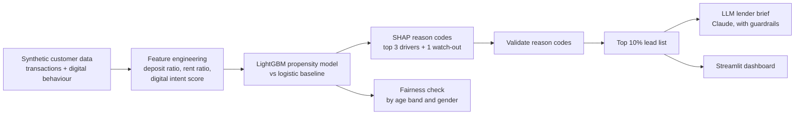

# First Home Buyer Lead Intelligence

**Which everyday-banking customers are about to apply for their first home loan, and why?**

> **Part 1 of 4 in a lending AI series:** **1. Predict who will apply** → [2. Target who a call changes](https://github.com/Shru2006/outreach-uplift-modelling) → [3. Test the LLM's briefs](https://github.com/Shru2006/llm-brief-evals) → [4. Monitor it in production](https://github.com/Shru2006/model-monitoring-pipeline)

**At a glance:**
- Calling the top 10% of customers ranked by a LightGBM propensity model reaches **49% of future applicants**, a **4.9x lift** over random outreach (ROC-AUC 0.846 on 12,500 held-out customers).
- Every lead comes with **SHAP reason codes** in plain English and a short **lender brief written by Claude** under guardrails, in a Streamlit app.
- **Age and gender are never model inputs.** They are kept only for fairness monitoring, and reason codes are validated so tampered text can't reach the brief.

`Python 3.12` · `LightGBM` · `SHAP` · `Claude API` · `Streamlit` · `GitHub Actions` · `pytest`

> **All data is synthetic**, generated by `src/generate_data.py`. No real customer information. A personal portfolio project, not affiliated with or endorsed by any bank. It is a marketing propensity model, not a credit decision, and nothing here is financial advice.

---

## 1. The problem

Most first home buyers bank somewhere for years before they apply, and their everyday banking quietly signals that they're getting ready: savings building up, steady rent payments, and research such as borrowing-power calculator use.

Home lending teams have limited time. Contacting customers at random wastes most conversations and misses the customers who are genuinely ready, or lets another lender reach them first.

**Goal:** rank existing customers by how likely they are to apply for their first home loan in the next 90 days, explain *why* each one was flagged, and give the lender a short, compliant conversation brief.

## 2. Approach



| Step | File | What it does |
|---|---|---|
| Data | [`src/generate_data.py`](src/generate_data.py) | 50,000 synthetic customers with realistic Australian income, rent, savings and digital behaviour, and a hidden process that decides who applies. |
| Features | [`src/features.py`](src/features.py) | Business-meaningful signals: deposit-to-income, rent-to-income, consistent renter, a combined digital intent score. Asserts no target leakage and no protected attributes. |
| Model | [`src/train.py`](src/train.py) | Logistic regression baseline and LightGBM with early stopping. Evaluated with ROC-AUC, PR-AUC, Brier score, lift and cumulative gains. Also runs the fairness check. |
| Explainability | [`src/explain.py`](src/explain.py) | LightGBM's native TreeSHAP turns each score into plain-English reason codes. |
| LLM brief | [`src/lead_brief.py`](src/lead_brief.py), [`prompts/`](prompts/) | Validates reason codes, then sends *only* the score and reason codes to Claude, which writes the brief. Falls back to a template when no API key is set. |
| App | [`app.py`](app.py) | Streamlit dashboard to filter leads, inspect drivers and generate briefs. |
| Pipeline | [`src/pipeline.py`](src/pipeline.py) | Runs every step with one command. CI runs it on every push. |

## 3. Results

Held-out test set: 12,500 customers, base application rate 5.7%.

| Model | ROC-AUC | PR-AUC | Top-10% lift | Applicants captured in top 10% |
|---|---|---|---|---|
| Logistic regression (baseline) | 0.821 | 0.263 | 4.3x | 43% |
| **LightGBM** | **0.846** | **0.310** | **4.9x** | **49%** |

<p float="left">
  
  
</p>

**What drives the score:** digital home-buying intent (calculator use, home loan page views, property searches) and deposit readiness (savings relative to income) dominate, followed by savings momentum. Stretched credit and heavy buy-now-pay-later use pull scores down.

**Example lender brief** (more in [`reports/sample_lead_briefs.md`](reports/sample_lead_briefs.md)):

```
C126918 · score 0.88

Why this customer
- Overall digital home-buying intent (high)
- Recent conversation with a lender (yes)
- Savings growth over the last 6 months (+21.4%)

Suggested conversation opener
- "We noticed you've been exploring home buying. Would a quick chat about your
  borrowing power and first home buyer options be useful?"
```

## 4. Responsible AI, design decisions and limitations

**Guardrails** (summarised in the [model card](MODEL_CARD.md)):
- **No protected attributes in the model.** Age and gender are excluded from the features, and a unit test enforces it.
- **Fairness monitoring.** Selection rate into the top 10% by age band and gender ([`reports/fairness_test.csv`](reports/fairness_test.csv)). The lowest selection-rate ratio is 0.80 for age bands and 0.90 for gender, among groups with 500+ customers. Differences come through proxies (younger customers have smaller savings balances), so this would be reviewed with risk and compliance before any real use.
- **The LLM explains, it does not decide.** The model selects leads. The LLM only rewords the reason codes it's given, and the prompt forbids invented facts, protected attributes and promises about approval or rates.
- **Untrusted text never reaches the brief.** A reason code is used only if it has the exact shape `<known feature label> (<short value>)`. Anything else is withheld before it reaches the template or Claude. This gap was found, and the fix verified, by [part 3 of the series](https://github.com/Shru2006/llm-brief-evals).

| Decision | Why |
|---|---|
| Judge models on **lift and capture in the top 10%**, not only ROC-AUC | Lenders can only call a small slice of customers, so the top of the list is what matters. PR-AUC is reported because applicants are rare. |
| Keep a **logistic regression baseline** | LightGBM has to earn its complexity. It adds 0.6x of lift: about 3 more applicants per 100 calls. |
| **SHAP reason codes**, not just global importance | A lender needs to know why *this* customer was flagged, in words they can use. |
| The **LLM only sees the score and reason codes** | It can't invent facts it was never given, and no other customer data leaves the pipeline. |

**Limitations:** the data is synthetic, so the results show the method, not real-world performance. The split is random rather than time-based. Propensity isn't persuadability: some top-ranked customers would apply anyway.

## 5. Run it yourself

```bash
git clone https://github.com/Shru2006/first-home-buyer-lead-intelligence.git
cd first-home-buyer-lead-intelligence
python -m venv .venv
.venv\Scripts\activate            # macOS/Linux: source .venv/bin/activate
pip install -r requirements.txt

python -m src.pipeline            # everything: data, training, reports, briefs
pytest -q                         # tests
streamlit run app.py              # the dashboard
```

Or step by step: `python -m src.generate_data`, then `python -m src.train`, then `python -m src.lead_brief --top 5`.

To use Claude for briefs, set `ANTHROPIC_API_KEY` first (billed to your Anthropic account). Without it, the rule-based template is used, so everything still runs.

## 6. Project structure

```
├── app.py                    Streamlit dashboard
├── MODEL_CARD.md             purpose, inputs, performance, fairness, limits
├── src/
│   ├── config.py             paths and settings
│   ├── generate_data.py      synthetic data generator
│   ├── features.py           feature engineering + plain-English labels
│   ├── train.py              training, evaluation, fairness, scoring
│   ├── explain.py            SHAP reason codes
│   ├── lead_brief.py         reason-code validation + LLM lender briefs
│   └── pipeline.py           runs every step
├── prompts/                  LLM system prompt
├── reports/                  metrics, charts, fairness table, sample briefs
├── tests/                    pytest checks
└── .github/workflows/        CI: tests + full pipeline on every push
```

## 7. What I would do next

Three of these became the rest of the series:
- **Target the customers a call changes**, not just those likely to apply: [outreach-uplift-modelling](https://github.com/Shru2006/outreach-uplift-modelling).
- **Test the LLM briefs** for faithfulness and compliance on every change: [llm-brief-evals](https://github.com/Shru2006/llm-brief-evals).
- **Monitor drift and retrain**, with time-based validation: [model-monitoring-pipeline](https://github.com/Shru2006/model-monitoring-pipeline).

Still open:
- **Feedback loop:** capture lender outcomes (contacted, interested, applied) as new training labels.
- **Calibration:** check that predicted probabilities match observed rates before using them for capacity planning ([calibration chart](reports/figures/calibration.png)).

---

**The series:** **1. Predict who will apply** · [2. Target who a call changes](https://github.com/Shru2006/outreach-uplift-modelling) · [3. Test the LLM's briefs](https://github.com/Shru2006/llm-brief-evals) · [4. Monitor it in production](https://github.com/Shru2006/model-monitoring-pipeline)

**Author:** Shruti Prabhu · [LinkedIn](https://www.linkedin.com/in/shruti-prabhu-32b77477) · [GitHub](https://github.com/Shru2006)
