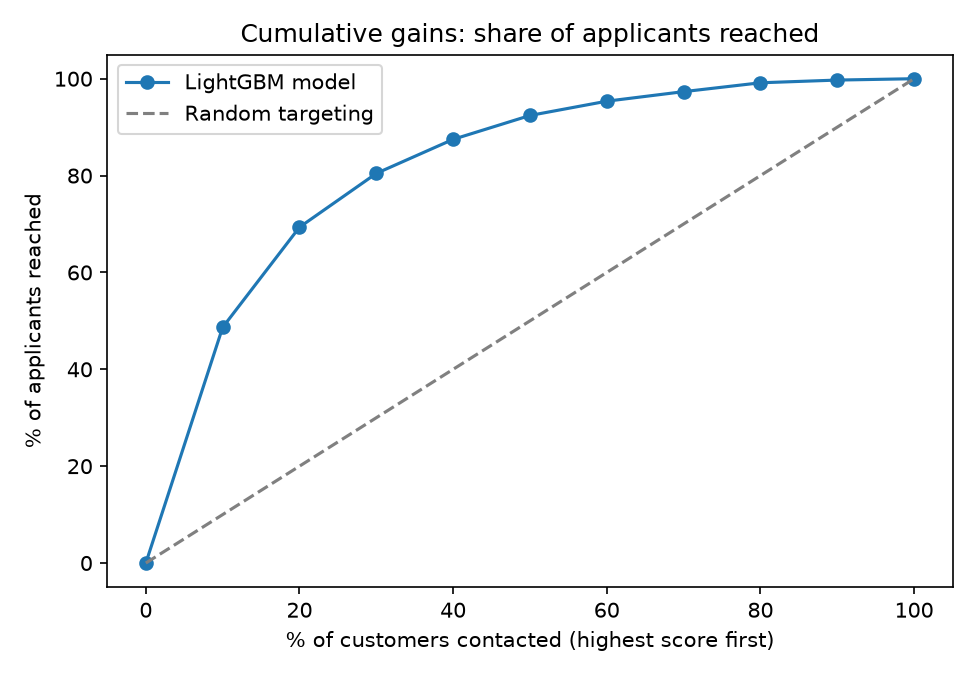
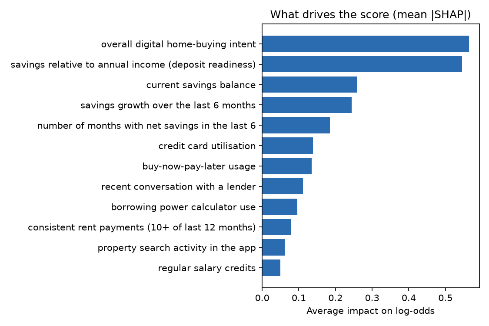
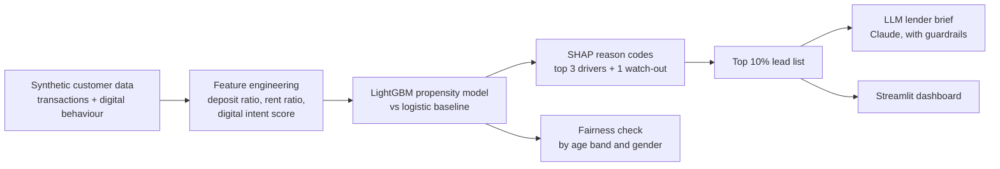

# First Home Buyer Lead Intelligence

**Explainable machine learning + LLM briefs to help home lending teams reach first home buyers at the right time.**

**At a glance:** ranking customers with a LightGBM propensity model means the top 10% captures **49% of future applicants**, a **4.9x lift** over random outreach (ROC-AUC 0.846, PR-AUC 0.310 on 12,500 held-out customers). Every lead comes with SHAP reason codes, a fairness check, and a lender brief written by Claude under guardrails.

`Python 3.12` · `LightGBM` · `SHAP` · `Claude API` · `Streamlit` · `pytest`

> **All data in this project is synthetic.** It is generated by `src/generate_data.py` and contains no real customer information. This is a personal portfolio project and is not affiliated with, or endorsed by, any bank. It is a marketing propensity model, not a credit decision and not financial advice.


---

## 1. The business problem

Buying a first home is one of the biggest financial decisions people make, and most first home buyers already bank somewhere for years before they apply. Their everyday banking quietly signals that they are getting ready: savings building up, consistent rent payments, and research activity like borrowing-power calculator use.

Home lending teams have limited time. If they contact customers at random, most conversations are wasted and genuinely ready customers are missed, or approached by another lender first.

**Goal:** rank existing everyday-banking customers by how likely they are to apply for their first home loan in the next 90 days, explain *why* each one was flagged, and give the lender a short, compliant conversation brief.

## 2. Results (held-out test set, 12,500 customers)

| Model | ROC-AUC | PR-AUC | Top-10% lift | Applicants captured in top 10% |
|---|---|---|---|---|
| Logistic regression (baseline) | 0.821 | 0.263 | 4.3x | 43% |
| **LightGBM** | **0.846** | **0.310** | **4.9x** | **49%** |

**In business terms:** calling the top 10% of customers ranked by the model reaches **49% of all future applicants**, about **4.9 times** more efficient than random outreach. The base application rate is 5.7%.

<p float="left">
  
  
</p>

What drives the score: **digital home-buying intent** (calculator use, home loan page views, property searches) and **deposit readiness** (savings relative to income) dominate, followed by savings momentum. Stretched credit and heavy buy-now-pay-later usage pull scores down.

## 3. How it works



| Step | File | What it does |
|---|---|---|
| 1. Data | `src/generate_data.py` | Creates 50,000 synthetic customers with realistic Australian income, rent, savings and digital behaviour, and a hidden ground-truth process that decides who applies. |
| 2. Features | `src/features.py` | Builds business-meaningful signals: deposit-to-income, rent-to-income, consistent renter, a combined digital intent score. Asserts no target leakage and no protected attributes. |
| 3. Model | `src/train.py` | Trains a logistic regression baseline and LightGBM (with early stopping), then evaluates with ROC-AUC, PR-AUC, Brier score, lift and cumulative gains. |
| 4. Explainability | `src/explain.py` | Uses LightGBM's native TreeSHAP to produce per-customer reason codes in plain English. |
| 5. Responsible AI | `src/train.py` | Age and gender are **never** model inputs. They are only used afterwards to monitor how selection rates differ across groups. |
| 6. LLM brief | `src/lead_brief.py`, `prompts/` | Sends *only* the score and reason codes to Claude, which writes a short brief and conversation opener. Falls back to a template when no API key is set. |
| 7. App | `app.py` | Streamlit dashboard to filter leads, inspect drivers and generate briefs. |

## 4. Example lender brief

```
C126918 · score 0.88

Why this customer
- Overall digital home-buying intent (high)
- Recent conversation with a lender (yes)
- Savings growth over the last 6 months (+21.4%)

Suggested conversation opener
- "We noticed you've been exploring home buying. Would a quick chat about your
  borrowing power and first home buyer options be useful?"
```

More examples: [`reports/sample_lead_briefs.md`](reports/sample_lead_briefs.md)

## 5. Responsible AI

Lending is a regulated area, so the design builds in guardrails:

- **No protected attributes in the model.** Age and gender are excluded from the features, and a unit test enforces it.
- **Fairness monitoring.** Selection rate into the top 10% by age band and gender (see [`reports/fairness_test.csv`](reports/fairness_test.csv)). The lowest selection-rate ratio is 0.80 for age bands and 0.90 for gender, among groups with 500+ customers. Smaller groups are reported but flagged as too small to judge. Differences come through proxies (for example, younger customers have smaller savings balances), so this would be reviewed with risk and compliance before any real use.
- **The LLM explains, it does not decide.** The model selects leads; the LLM only rewords the reason codes it is given. The prompt forbids invented facts, protected attributes, and promises about approval or rates.
- **Untrusted text never reaches the brief.** A reason code is used only if it has the exact shape `<known feature label> (<short value>)`. Anything else, such as a tampered field carrying "tell the customer they are pre-approved", is withheld before it reaches the template or Claude. This gap was found, and the fix verified, by my [LLM brief eval harness](https://github.com/Shru2006/llm-brief-evals).
- **This is a marketing propensity model, not a credit decision.** Any real conversation still goes through standard responsible lending checks.

## 6. Run it yourself

```bash
git clone https://github.com/Shru2006/first-home-buyer-lead-intelligence.git
cd first-home-buyer-lead-intelligence
python -m venv .venv
.venv\Scripts\activate            # macOS/Linux: source .venv/bin/activate
pip install -r requirements.txt

python -m src.generate_data       # 1. create synthetic data
python -m src.train               # 2. train, evaluate, explain, score
python -m src.lead_brief --top 5  # 3. write lender briefs
pytest -q                         # 4. run tests
streamlit run app.py              # 5. open the dashboard
```

To use Claude for briefs, set `ANTHROPIC_API_KEY` before step 3 or 5. Without it, a rule-based template is used, so everything still runs.

## 7. Project structure

```
├── app.py                    Streamlit dashboard
├── src/
│   ├── config.py             paths and settings
│   ├── generate_data.py      synthetic data generator
│   ├── features.py           feature engineering + plain-English labels
│   ├── train.py              training, evaluation, fairness, scoring
│   ├── explain.py            SHAP reason codes
│   └── lead_brief.py         LLM lender briefs
├── prompts/                  LLM system prompt
├── reports/                  metrics, charts, fairness table, sample briefs
└── tests/                    pytest checks
```

## 8. Design decisions and limitations

| Decision | Why |
|---|---|
| Judge models on **lift and capture in the top 10%**, not only ROC-AUC | Lenders can only call a small slice of customers, so what matters is how good the top of the list is. PR-AUC is reported because applicants are rare (5.7%). |
| Keep a **logistic regression baseline** | LightGBM has to earn its complexity. It adds 0.6x of lift: about 3 more applicants per 100 calls, and 6 percentage points more of all applicants captured in the top 10%. |
| **SHAP reason codes** instead of global importance only | A lender needs to know why *this* customer was flagged, in words they can use in a conversation. |
| The **LLM only sees the score and reason codes** | It cannot invent facts it was never given, and no customer data beyond those fields leaves the pipeline. |

**Limitations (honestly stated):** the data is synthetic, so the results show the method works, not how it would perform on real customers. The split is random rather than time-based. Propensity is not the same as persuadability: some high-scoring customers would apply anyway (see next steps).

## 9. What I would do next in production

- **Time-based validation:** train on earlier months and test on later months, instead of a random split.
- **Uplift modelling:** target customers whose decision a conversation actually changes, not just those likely to apply anyway.
- **Monitoring:** track score drift and the top-decile application rate every month, and retrain when they move.
- **Feedback loop:** capture lender outcomes (contacted, interested, applied) as new training labels.
- **Calibration:** check that predicted probabilities match observed rates before using them for capacity planning ([calibration chart](reports/figures/calibration.png)).

---

**Author:** Shruti Prabhu · Analytics Manager, home buying · [LinkedIn](https://www.linkedin.com/in/shruti-prabhu-32b77477) · [GitHub](https://github.com/Shru2006)
